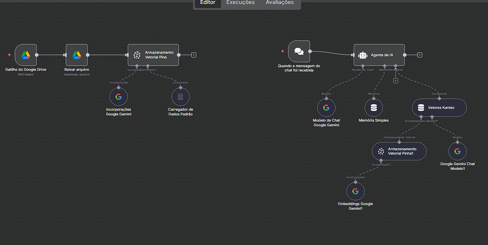

# Assistente de estudo das obras de Allan Kardec (RAG com n8n, Pinecone e Gemini)

Chatbot que responde perguntas sobre a Doutrina Espírita usando só os livros indexados num banco vetorial (RAG). Os PDFs colocados numa pasta do Google Drive são indexados automaticamente no Pinecone, e um agente com Gemini consulta esses trechos antes de responder.

🎥 [Vídeo de demonstração](https://www.linkedin.com/feed/update/urn:li:activity:7385082313673674752/)



## Arquitetura

O arquivo `RAG Pinecone.json` tem dois fluxos independentes.

### 1. Indexação

```text
Google Drive Trigger (arquivo novo na pasta "n8n RAG", verificação a cada minuto)
  → Download file
  → Pinecone Vector Store (modo insert)
       ├─ Default Data Loader: lê o PDF e grava o nome do arquivo no metadado "Livro"
       └─ Embeddings Google Gemini: gera os vetores
```

Os vetores ficam no índice `n8nteste2`, namespace `n8nrag`.

### 2. Chat

```text
When chat message received (chat público do n8n)
  → AI Agent (Gemini)
       ├─ Simple Memory: últimas 10 mensagens da conversa
       └─ Ferramenta "vetores kardec" (Vector Store Tool)
            ├─ Pinecone Vector Store1: busca no mesmo índice e namespace
            ├─ Embeddings Google Gemini1
            └─ Google Gemini Chat Model1: resume os trechos encontrados
```

O agente decide quando consultar a ferramenta. A ferramenta busca os trechos no Pinecone e devolve um resumo com a ideia central, as citações (obra, questão ou capítulo, quando o texto traz) e o contexto.

## Como o agente responde

O prompt separa o que é texto da doutrina do que é interpretação:

1. **Base doutrinária explícita:** o que as obras dizem diretamente, com a fonte. Se o tema não aparece nas obras, o agente diz isso.
2. **Princípios e interpretação:** explicação a partir dos princípios gerais, sinalizada como interpretação.
3. **Nota contextual externa (opcional):** visões de fora da codificação, marcadas como tal.

O acervo pensado é: O Livro dos Espíritos, O Livro dos Médiuns, O Evangelho Segundo o Espiritismo, O Céu e o Inferno, A Gênese e a Revista Espírita (1858–1869).

## Arquivos

| Arquivo | Conteúdo |
|---|---|
| `RAG Pinecone.json` | Workflow exportado do n8n (indexação + chat) |
| `docs/workflow.png` | Captura do workflow |
| `.env.example` | Lista das chaves necessárias |

## Como executar

1. Crie um índice no Pinecone com métrica *cosine* e a mesma dimensão do modelo de embedding escolhido no nó `Embeddings Google Gemini` (por exemplo, `text-embedding-004` gera vetores de 768 dimensões). Se as dimensões não baterem, o Pinecone recusa a inserção.
2. No n8n, importe `RAG Pinecone.json` (menu **Workflows → Import from File**).
3. Crie as credenciais e selecione-as nos nós:
   - **Google Drive OAuth2**: `Google Drive Trigger` e `Download file`
   - **Pinecone API**: `Pinecone Vector Store` e `Pinecone Vector Store1`
   - **Google Gemini (PaLM) API**: os dois nós de embeddings e os dois de chat
4. Nos dois nós do Pinecone, escolha o seu índice. No `Google Drive Trigger`, escolha a sua pasta.
5. Ative o workflow e coloque os PDFs na pasta. Cada arquivo novo é indexado em até um minuto.
6. Abra a URL do nó `When chat message received` para conversar.

> As chaves ficam nas credenciais do n8n. O workflow não lê variáveis de ambiente; o `.env.example` serve só como lista do que é preciso.

## Limitações conhecidas

- **Memória em RAM.** O `Simple Memory` perde o histórico quando o n8n reinicia e não funciona em modo fila (*queue mode*). Em produção, o ideal é memória em Postgres ou Redis.
- **Sem número de página.** O único metadado salvo é o nome do arquivo. A fonte citada depende de o próprio trecho conter o número da questão ou do capítulo.
- **Reindexação duplica.** Enviar o mesmo PDF de novo insere os vetores outra vez; não há limpeza nem verificação de duplicados.
- **Chat público.** O chat está com acesso público. Antes de divulgar a URL, vale ativar autenticação ou limitar o uso para controlar o custo da API.

## Autor

**Michael Douglas Teofilo**
[LinkedIn](https://www.linkedin.com/in/michael-douglas-automacao-ia/) · [GitHub](https://github.com/Michael-MDT22)
